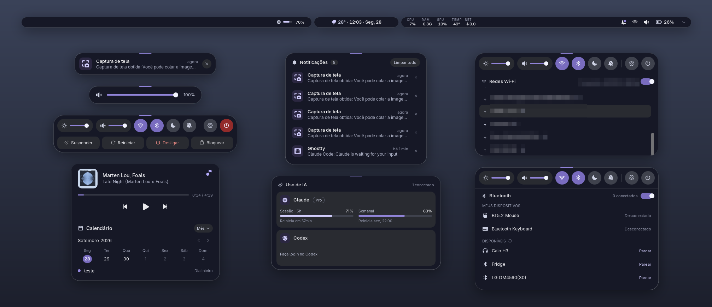

# Island

Extensão do **GNOME Shell** que troca a barra superior por três pílulas flutuantes. A do centro, a **Island**, funciona como uma Dynamic Island para o desktop: cresce conforme o contexto e reúne notificações, música, volume, brilho, calendário e controles rápidos.



[Site](https://islandesktop.vercel.app/) · [Última release](https://github.com/CaioNazario/island-desktop/releases/latest) · [Changelog](CHANGELOG.md)

## Instalação

Requer **GNOME Shell 50** no **Wayland**.

Baixe o `island@caionazario.dev.shell-extension.zip` da [última release](https://github.com/CaioNazario/island-desktop/releases/latest) e instale:

```sh
gnome-extensions install --force island@caionazario.dev.shell-extension.zip
```

O Wayland não recarrega extensões em quente: faça **logout e login** e depois ative:

```sh
gnome-extensions enable island@caionazario.dev
```

Para atualizar, repita a instalação com o zip novo e faça logout e login. Para remover:

```sh
gnome-extensions uninstall island@caionazario.dev
```

Ao desativar, o painel padrão do GNOME volta como era.

<details>
<summary>Instalar pelo código</summary>

Precisa de Node.js 22, npm e `glib-compile-schemas`.

```sh
git clone https://github.com/CaioNazario/island-desktop.git
cd island-desktop
npm ci
./install.sh              # compila e instala em ~/.local/share/gnome-shell/extensions/
./install.sh --uninstall  # remove
```

</details>

## Recursos

### Island

Compacta, mostra o relógio, o dia da semana e o clima. Ela se abre sozinha por alguns segundos quando algo acontece (notificação, troca de música, tecla de volume ou brilho, troca de ambiente) e fica aberta enquanto o ponteiro estiver sobre ela. Os painéis que você abre (calendário, controles rápidos, Wi‑Fi, Bluetooth, uso de IA, nota) ficam até um clique fora ou `Esc`.

Um evento nunca derruba o que você abriu: com o calendário aberto, uma notificação aparece como banner abaixo da ilha.

Clicar na Island compacta abre o **cartão central** (música, calendário da semana ou do mês e os eventos do dia) ou só o calendário, conforme as preferências.

### Ambientes e widgets

Um ambiente é um conjunto de widgets para as pílulas laterais. Vêm quatro prontos, e dá para ter até seis:

| Ambiente | Esquerda | Direita |
|---|---|---|
| Padrão | Uso de IA | Hardware |
| Trabalho | Próximo evento, Pomodoro, Uso de IA | Hardware, GitHub |
| Estudos | Progresso do dia, Pomodoro | Nota |
| Fim de semana | Música | Contagem regressiva |

| Widget | Mostra |
|---|---|
| Uso de IA | Sessão e limite semanal do Claude e do Codex |
| Hardware | CPU, RAM, GPU Intel/AMD, temperatura e rede |
| Próximo evento | O próximo compromisso do dia |
| Pomodoro | Ciclos de 25 min de foco e 5 min de pausa |
| Música | O que está tocando |
| GitHub | Seus PRs abertos e quantos esperam sua revisão |
| Progresso do dia | Quanto do dia já passou |
| Contagem regressiva | Dias até uma data |
| Nota | Um recado fixo na barra |

O botão no início da pílula esquerda abre o **editor**: criar, renomear e excluir ambientes, arrastar widgets do catálogo para a barra, reordenar e ligar o **auto-ocultar**. Com o auto-ocultar ligado, a barra sai da tela e volta quando você empurra o ponteiro contra a borda de cima ou quando a Island abre.

Sem espaço, o Hardware perde blocos (rede, GPU, temperatura) e depois somem widgets inteiros, a começar pelo mais longe da Island.

### Notificações

Aparecem na Island e ficam numa lista com as 8 mais recentes. Em navegadores Chromium, alertas web mostram o site de origem (WhatsApp, Discord, YouTube) em vez do navegador. Com **Não perturbe** ligado, vão direto para a lista.

### Música

Qualquer player com **MPRIS**, inclusive Spotify e players no navegador: capa, título, artista e controles.

### Controles rápidos

`Super+S` abre volume, brilho, Wi‑Fi (com senha digitada na própria ilha), Bluetooth (com pareamento), modo noturno, Não perturbe, configurações e a linha de energia (suspender, reiniciar, desligar, sair, bloquear).

### Clima, bateria e temas

- **Clima**: pela cidade escolhida nas preferências, pelas localizações do GNOME ou pelo Geoclue.
- **Bateria**: desenhada na barra, verde a partir de 90%, vermelha até 20% e com um raio enquanto carrega.
- **Temas**: Nocturne (padrão) e Alto contraste, escolhidos nas preferências.

## Atalhos e gestos

| Ação | Como |
|---|---|
| Controles rápidos | `Super+S` |
| Trocar de ambiente | Rolagem horizontal sobre a barra, `Super+Ctrl+←/→` ou um dos pontos do botão de ambiente |
| Fechar o que está aberto | `Esc` ou clique fora |
| Lista de notificações | Clique numa notificação ou no sino |
| Editor de ambientes | Clique no botão de ambiente |

## Preferências

```sh
gnome-extensions prefs island@caionazario.dev
```

Tema, o que o clique na Island abre, cidade do clima, provedores de IA, contagem regressiva e o estado do `gh`. Ambientes, auto-ocultar e a nota se editam direto na barra.

Recursos que dependem de algo do sistema:

| Recurso | Requer |
|---|---|
| Eventos do calendário | Uma conta online configurada no GNOME (Evolution Data Server) |
| Clima | `libgweather-4`; sem cidade escolhida, a localização ligada para o Geoclue |
| Uso de IA | Login no Claude Code (`~/.claude/.credentials.json`) ou no Codex CLI (`~/.codex/auth.json`) |
| GitHub | [`gh`](https://cli.github.com/) com `gh auth login` feito |

## Uso de IA: leia antes

O widget **não usa APIs oficiais**. Com um provedor ligado, a extensão lê o token OAuth que o CLI já guardou e consulta endpoints de uso **não documentados** da Anthropic e da OpenAI. O do Claude exige o User-Agent do Claude CLI, então a extensão se identifica como ele.

A extensão nunca altera os arquivos de credenciais nem renova tokens; só relê o arquivo quando o CLI o atualiza. Esses endpoints podem mudar ou sumir a qualquer momento: se a resposta vier num formato inesperado, o cartão de IA mostra um erro e o resto da extensão segue funcionando. Sem credencial válida, o widget mostra só "IA". Para não usar, desligue os provedores nas preferências.

## Limitações

- Só GNOME Shell 50 e Wayland, validado no Arch Linux.
- Monitores com menos de 1280px lógicos de largura não são suportados.
- A barra fica só no topo e não tem o botão Atividades, AppIndicator/bandeja nem troca de layout do teclado.
- GPUs NVIDIA não aparecem no bloco de hardware.
- Notificações não têm botões de ação, e as do Firefox não mostram o site de origem.
- Ainda não está no extensions.gnome.org.

## Desenvolvimento

```sh
npm ci
make test    # Vitest
make lint    # ESLint, Prettier e tsc
make build   # compila em dist/
make pack    # gera o zip da release
make dev     # GNOME Shell aninhado (--devkit)
```

O Shell aninhado carrega a extensão **instalada**: rode `./install.sh` antes do `make dev`.

O código separa as regras (`src/core/`, TypeScript puro e testado), a integração com o sistema (`src/system/`: MPRIS, NetworkManager, GnomeBluetooth, UPower, GWeather e o calendário do Shell) e a interface (`src/ui/`, St/Clutter). O comportamento está nas specs, a partir de [`specs/00-visao-geral.md`](specs/00-visao-geral.md); as regras do projeto, inclusive o fluxo das branches `dev` e `main` e das releases, em [`AGENTS.md`](AGENTS.md).

Para ligar o log de debug, `touch ~/.cache/island-debug`, faça logout e login e leia com:

```sh
journalctl -b -o cat /usr/bin/gnome-shell | grep ISLANDDBG
```

## Licença

[GPL-3.0-or-later](LICENSE)
